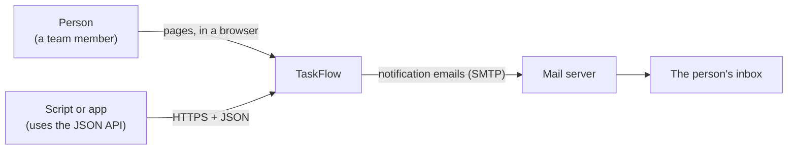
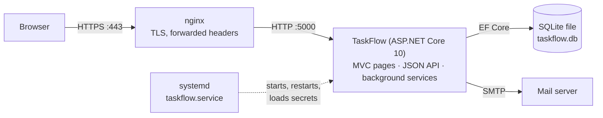
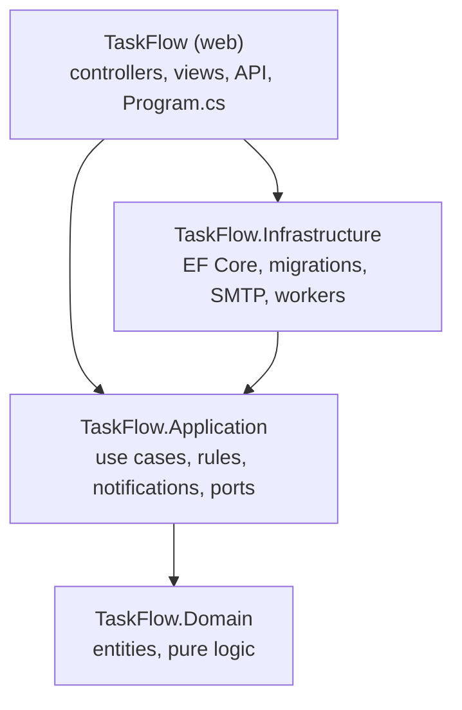
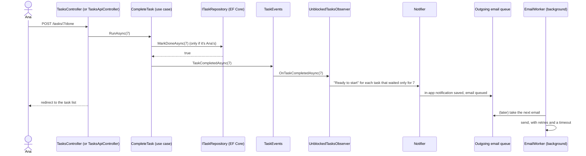

# TaskFlow architecture

Course 2, Chapter 23. How TaskFlow is put together, in four diagrams, from the outside in.
The diagrams are **text** (Mermaid): GitHub draws them, they're reviewed in pull requests like code,
and `git log` shows how they changed. Details: [design/modules.md](design/modules.md); decisions: [adr/](adr/).

## 1. Context: who uses TaskFlow, and what it talks to

TaskFlow has two front doors, the web pages and the JSON API, and one outside dependency: a mail server.

## 2. Containers: what runs where

One process does everything, including the background services (the email worker and the due-date reminders).
That's deliberate for a small product: one thing to deploy, one log, one database file to back up.
Chapter 27 revisits it when we look at scaling.

## 3. Inside the process: four projects, one direction

Dependencies point inwards: the Domain knows nothing else; the Application defines interfaces (ports) such as
`ITaskRepository` and `IEmailSender`; Infrastructure implements them. Only `Program.cs`, the composition root,
knows all four ([ADR 0001](adr/0001-separate-projects-for-layers.md)). Architecture tests fail the build if a
reference points the wrong way.

## 4. A flow: marking a task done

The request returns before any email is sent: slow mail servers never slow down the page (Chapter 16).
An observer that fails is logged and skipped, so completing a task never fails because of a notification.

## What's not here (yet)

- Teams (release 1.2): see [planning/release-1.2-teams.md](planning/release-1.2-teams.md) and [proposals/0001-team-ownership.md](proposals/0001-team-ownership.md).
- More than one server: SQLite and the in-memory email queue assume one process (tech debt TD-13, [tech-debt.md](tech-debt.md)).
