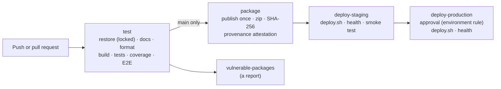

# Continuous integration and deployment

Course 2, Chapter 24. How a change gets from a pull request to production: `.github/workflows/ci.yml`.



## The rules

| Rule | Why | Where |
|---|---|---|
| Every push and pull request runs `test` | a broken main is everyone's problem | `on: push, pull_request` |
| Restore with `--locked-mode` | the exact package versions that were reviewed, nothing newer | `packages.lock.json` per project |
| The SDK version comes from `global.json` | the same compiler on every machine and in CI | `global.json` |
| Build once; deploy the same files everywhere | what you tested is what you ship | `package` job, artifact `taskflow-<sha>` |
| Check the package before deploying | nothing changed on the way | `sha256sum --check` |
| Deploy, check health, roll back by itself | a bad release never stays live | `Deploy/deploy.sh` |
| Production can require an approval | a person decides when | GitHub → Settings → Environments → production → Required reviewers |
| Actions pinned to a commit SHA; least `permissions` | a moved tag or a compromised action can't change the pipeline | `ci.yml`, `.github/dependabot.yml` |

## When the build is red

1. Open the failed run: `gh run view <id>`, or the Actions tab. Find the **first** red step.
2. Read its log: `gh run view <id> --log-failed`. The last lines usually say what's wrong.
3. Reproduce it locally with the same command (each step is a plain `dotnet …` or `bash …` command).
4. Fix forward with a small commit, or revert the commit that broke it. Don't leave `main` red.

## Deployment and rollback

`Deploy/deploy.sh <server> <published files> <version> [settings]` keeps every release in `releases/<version>/`,
points `current` at the live one, restarts, and waits up to 20 seconds for `/health` to answer `Healthy`.
If it doesn't, it points `current` back at the previous release and restarts that. Try it on your machine:

```bash
dotnet publish TaskFlow -c Release -o /tmp/pub
bash Deploy/deploy.sh /tmp/server /tmp/pub v1                    # healthy: deployed
bash Deploy/deploy.sh /tmp/server /tmp/pub v2 'ConnectionStrings__TaskFlow=Data Source=/no/such/dir/x.db'   # rolls back to v1
```

In this course TaskFlow has no real servers: in CI, "staging" and "production" are folders on the runner.
On a real server, the same script runs over SSH, with `systemctl restart taskflow` instead of starting the process itself.

## Supply chain

- `packages.lock.json` + `--locked-mode`; NuGet audit fails the restore on a known vulnerability (Chapter 20).
- Dependabot opens weekly, grouped pull requests for NuGet packages and GitHub Actions; CI decides.
- Each package gets a signed **build provenance attestation**: `gh attestation verify taskflow.zip --repo guysnove/taskflow`
  proves it was built by this workflow, from this repository, at that commit.
