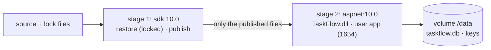

# Containers

Course 2, Chapter 25. How to run TaskFlow in a container, on your machine or a server, and what the image contains.

## Quick start

You need Docker (Docker Desktop on Windows and macOS; Docker Engine on Linux) with Compose.

```bash
docker compose up -d --build --wait     # build the image, start TaskFlow, wait until it's healthy
# open http://localhost:8080 and register
docker compose logs --tail 20           # what it printed
docker compose down                     # stop it; the data stays in the volume
```

For development (sample tasks, OpenAPI at `/openapi/v1.json`, `/debug/routes`), add the development file:

```bash
docker compose -f compose.yaml -f compose.dev.yaml up -d --build --wait
```

## The image (`Deploy/Dockerfile`)



| Choice | Why |
|---|---|
| Two stages | the SDK (about 1 GB) builds; only the runtime and the published files ship |
| Project files and lock files copied first, then `restore --locked-mode` | the restore layer is cached until a dependency changes; exactly the reviewed versions |
| `USER $APP_UID` | not root: a break-in gets an ordinary user |
| `/data` created and owned by that user, then `VOLUME /data` | the database and sign-in keys outlive the container. Without the `chown`, the first start failed with `SQLite Error 14` |
| No curl in the image | less to attack; Compose's health check uses bash's `/dev/tcp` |
| Base images are build arguments | CI uses Microsoft's; a mirror or a newer patch needs no edit |

`DockerfileTests` fail if a project TaskFlow ships is missing from the Dockerfile, or if restore isn't locked.

## Settings

The image sets `ASPNETCORE_ENVIRONMENT=Production`, port 8080, the database at `/data/taskflow.db` and the sign-in keys in
`/data/keys`. Everything else is an environment variable ([configuration.md](configuration.md)): in `compose.yaml`
under `environment:`, or `docker run -e TaskFlow__SiteName=…`. Secrets (`Email__Password`) go in an `.env` file that is
never committed, or your platform's secret store; never in the image, where anyone with the image can read them.

`compose.yaml` writes emails as files to `/data/outbox`. To send real email, set `Email__Host` and remove `Email__PickupDirectory`.

## Data

| Command | The data |
|---|---|
| `docker compose down`, `up` again, rebuild the image | kept (named volume `taskflow-data`) |
| `docker compose down --volumes` | **deleted** |
| `docker run` without `-v taskflow-data:/data` | in an anonymous volume, lost track of when the container is removed |

Back up: `docker compose cp taskflow:/data/taskflow.db ./backup.db` while TaskFlow is stopped (SQLite keeps recent
changes in `taskflow.db-wal` while it runs).

## In CI

The `container` job builds the image with Microsoft's base images on every push and pull request, runs it, checks
`/health` and the sign-in page, and checks the data survives a new container. On `main` it pushes the image to
`ghcr.io/guysnove/taskflow:<commit sha>`. A tag can be moved; the image's **digest** (`sha256:…`, printed by the push)
can't: deploy by digest when you need exactly the image you tested.

## A note on the course recording

The machine that recorded Chapter 25 could not reach any container registry. It built its own base images from Ubuntu's
packages (`exercises/ch25/bases/make-bases.sh`) and passed them as `SDK_IMAGE`/`RUNTIME_IMAGE`. CI uses Microsoft's.
